<div align="center">

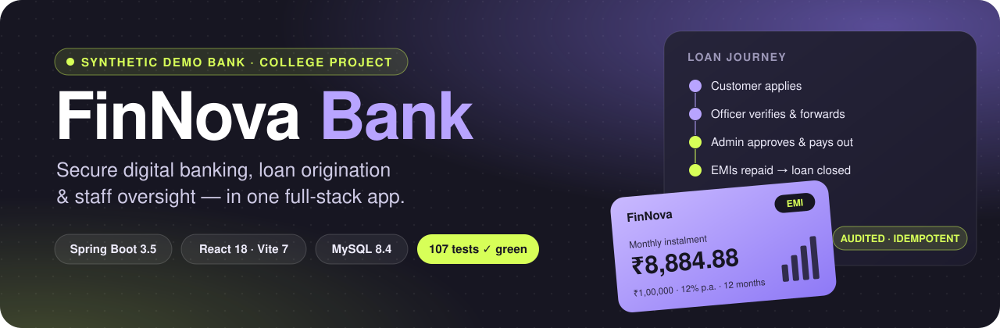

<br/>


**A full-stack banking & loan-management web app — built as a college lab project with 100% synthetic data.**

[✨ Features](#features) ·
[📸 Screens](#screens) ·
[🏗️ Architecture](#architecture) ·
[🔄 How it works](#how-it-works) ·
[🗄️ Data model](#data-model) ·
[🔐 Security](#security) ·
[🚀 Run it](#getting-started) ·
[🧪 Tests](#tests)

</div>

> [!IMPORTANT]
> **Synthetic demo only.** FinNova Bank moves *pretend* money between *pretend* accounts. There is no connection to UPI, NEFT, card networks or any real bank, and no real personal data or identity documents are stored.

---

<a id="features"></a>

## ✨ What it does

Three roles, three workspaces — every rule is enforced **on the server**, not just hidden in the menu.

<table>
<tr>
<td width="33%" valign="top">

### 🙋 Customer
- Register and sign in
- Dashboard: balances, recent activity, loans, KYC status
- Open, rename and close accounts
- **Transfer money** with masked recipient lookup and a downloadable **PNG receipt**
- Searchable, filterable transaction history
- Compare loan products, get a live **EMI quote**
- Apply for a loan (draft → submit → resubmit)
- Repay instalments safely (no double payment)

</td>
<td width="33%" valign="top">

### 🧑‍💼 Loan Officer
- **Officer Center** with a role-specific sidebar
- KYC review queue — verify or reject with a reason
- Review loan applications, request more info
- **Verify & forward** applications to the Admin
- Own decision history and own audit trail
- Loan-portfolio view — *no access to customer balances*

</td>
<td width="33%" valign="top">

### 🛡️ Admin
- **Admin Center** workspace
- **Final approval & pay-out** of forwarded loans
- Users: search, activate / deactivate, roles, approval limits, add officers
- Loan products: create, edit, soft-deactivate
- Monitor every officer's activity
- Audit-log search, dashboards and reports
- Idempotent account credit, overdue scan, demo date

</td>
</tr>
</table>

---

<a id="screens"></a>

## 📸 Screens

> [!NOTE]
> UI previews rendered with synthetic sample data.

<table>
<tr>
<td colspan="2" align="center">
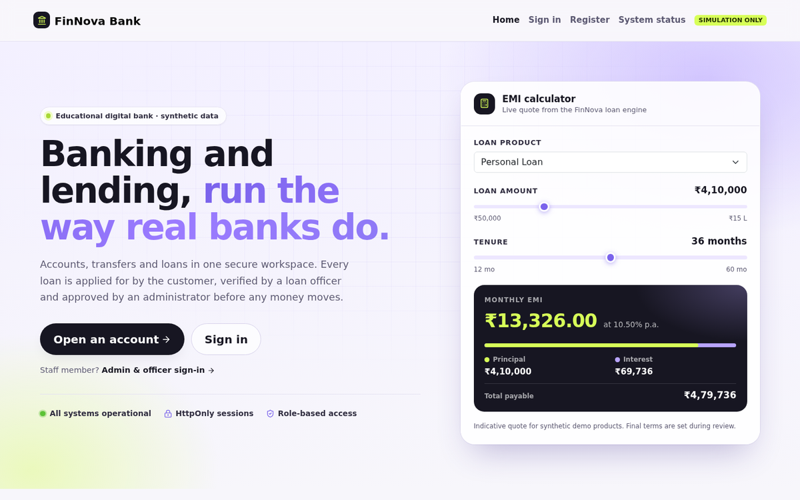<br/>
<sub><b>Public home page</b> — live backend status pill and an EMI calculator that asks the real quote API</sub>
</td>
</tr>
<tr>
<td width="50%" align="center">
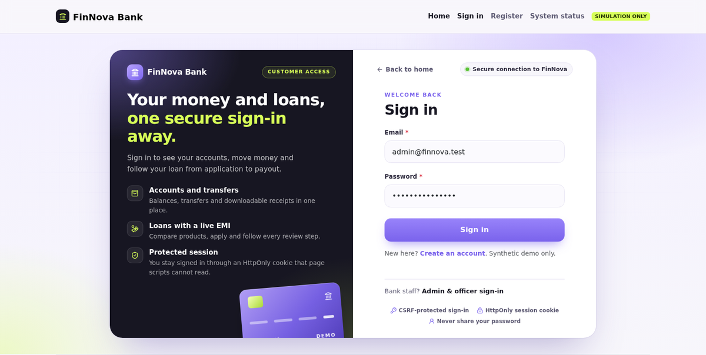<br/>
<sub><b>Sign-in (customer)</b> — two-panel layout, Caps Lock warning</sub>
</td>
<td width="50%" align="center">
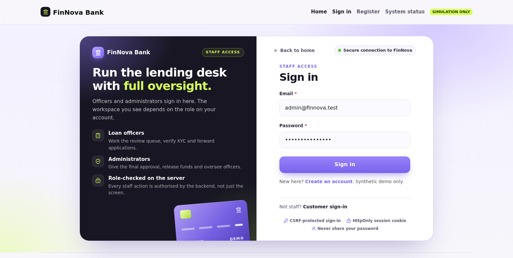<br/>
<sub><b>Sign-in (staff)</b> — opened from <code>/login?next=admin</code></sub>
</td>
</tr>
<tr>
<td width="50%" align="center">
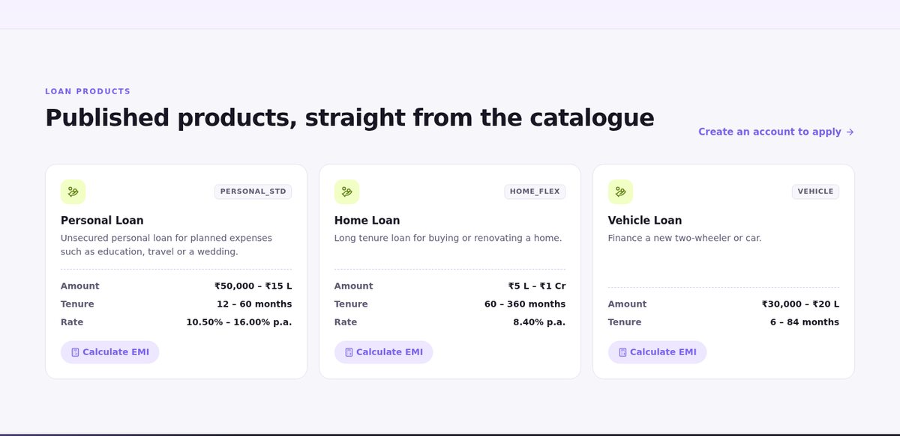<br/>
<sub><b>Loan products</b> — loaded from <code>GET /api/loan-products</code></sub>
</td>
<td width="50%" align="center">
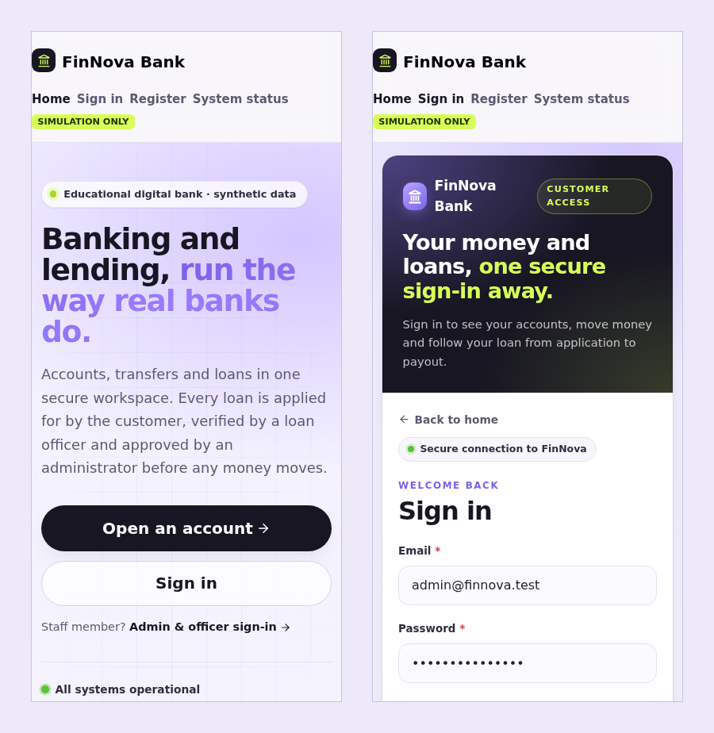<br/>
<sub><b>Responsive</b> — single-column layout on phones</sub>
</td>
</tr>
</table>

<details>
<summary><b>More screens</b></summary>
<br/>
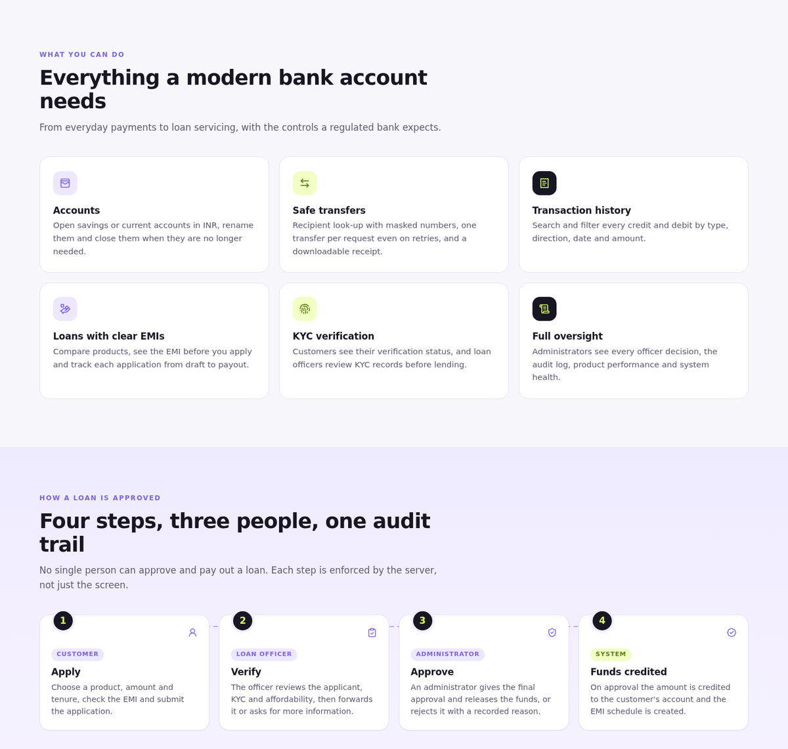
<p align="center"><sub>Features grid and the four-step loan journey</sub></p>
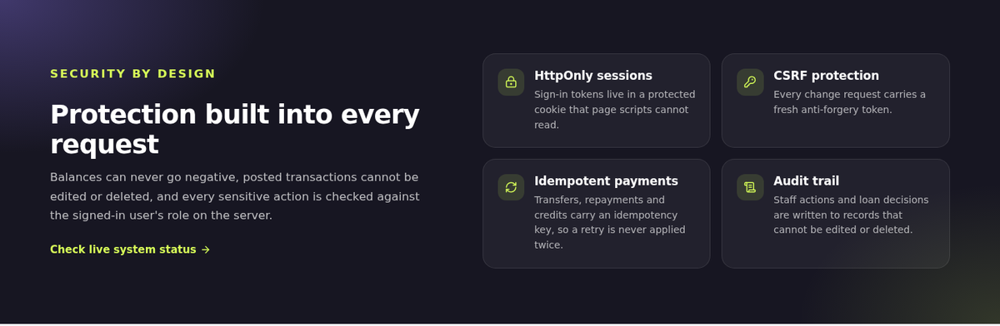
<p align="center"><sub>Security band — each statement is backed by code (HttpOnly cookies, CSRF, idempotency keys, immutable records)</sub></p>
</details>

---

<a id="architecture"></a>

## 🏗️ Architecture

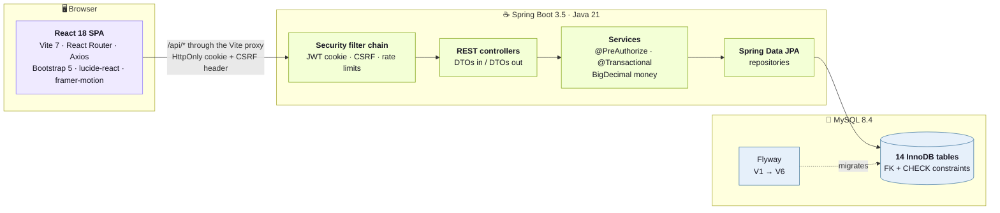

| Layer | Responsibility |
|---|---|
| **Frontend** | Pages, forms, role-aware navigation. Calls the API with *relative* URLs; no tokens in `localStorage`. |
| **Filters** | Read the `FN_ACCESS` HttpOnly JWT cookie, enforce CSRF on every state-changing request, rate-limit financial endpoints. |
| **Controllers** | HTTP only — validate DTOs, never expose entities. |
| **Services** | Business rules, ownership checks, `@PreAuthorize` role checks, transactions, locking. |
| **Database** | Last line of defence: foreign keys, `CHECK` constraints (e.g. balance ≥ 0, rejection needs a reason), restricted runtime grants. |

---

<a id="how-it-works"></a>

## 🔄 How it works

### 1 · Signing in

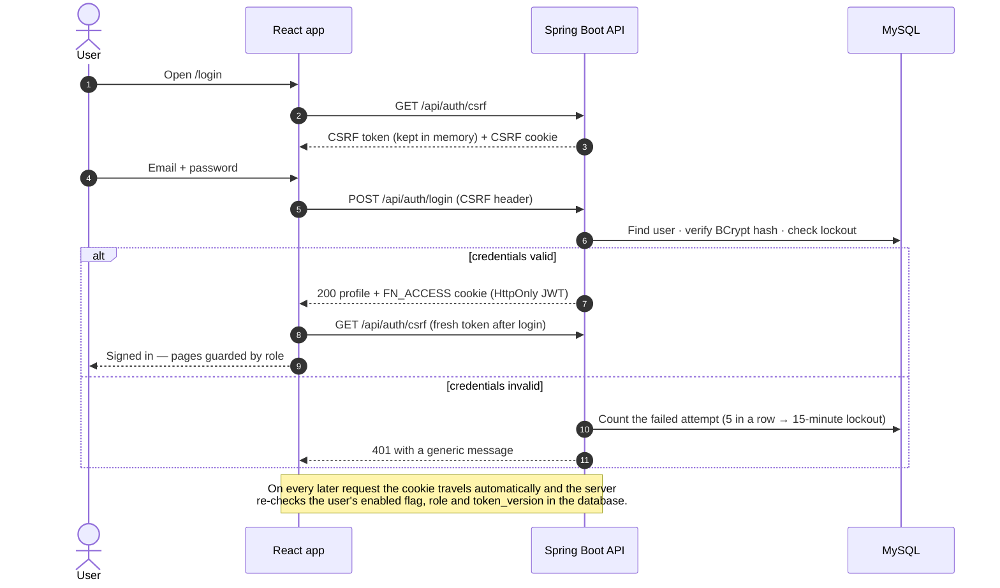

> Logout or a password change bumps `token_version`, so **every** old token stops working immediately.

### 2 · Sending money

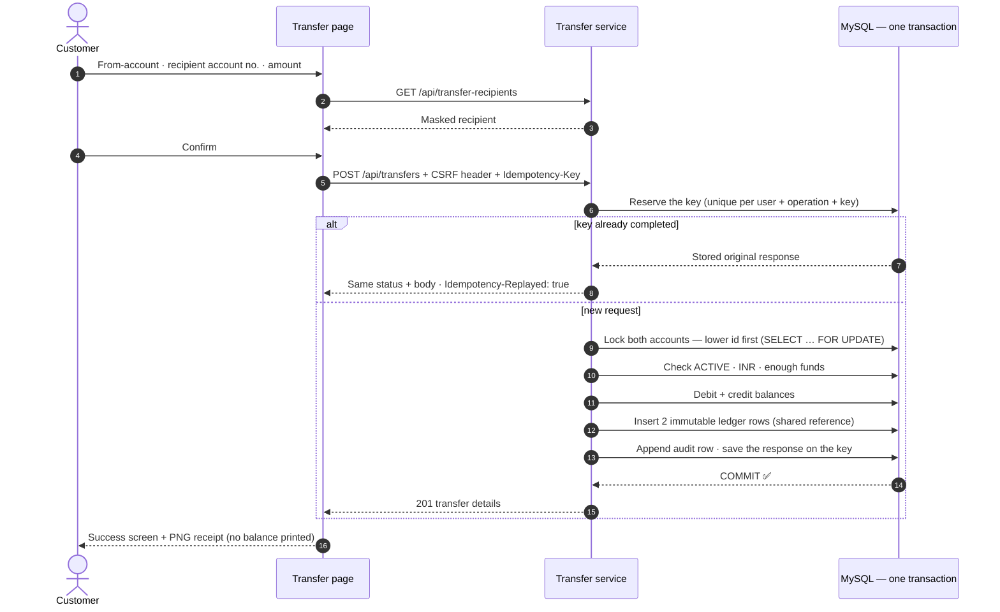

Double-click, flaky network, retry — the same key can **never** move money twice, and any failure rolls back *everything* (balances, ledger, audit, key).

### 3 · The loan lifecycle

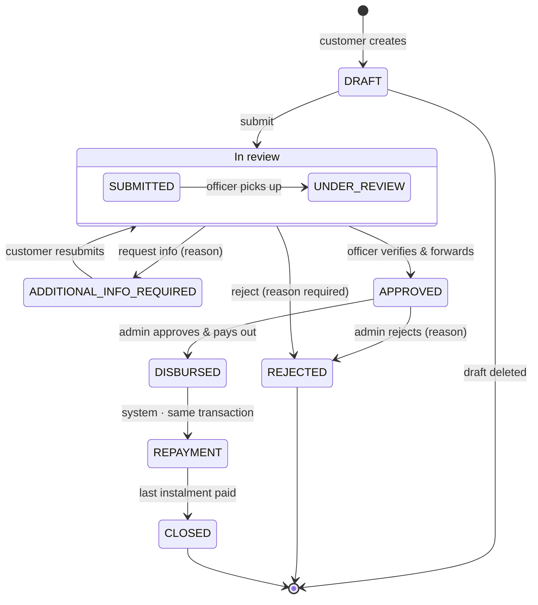

Every arrow writes a **history row** (who, when, why) and an **audit row**. Invalid jumps are refused with `409`, wrong roles with `403`.

### 4 · Who does what in the loan chain

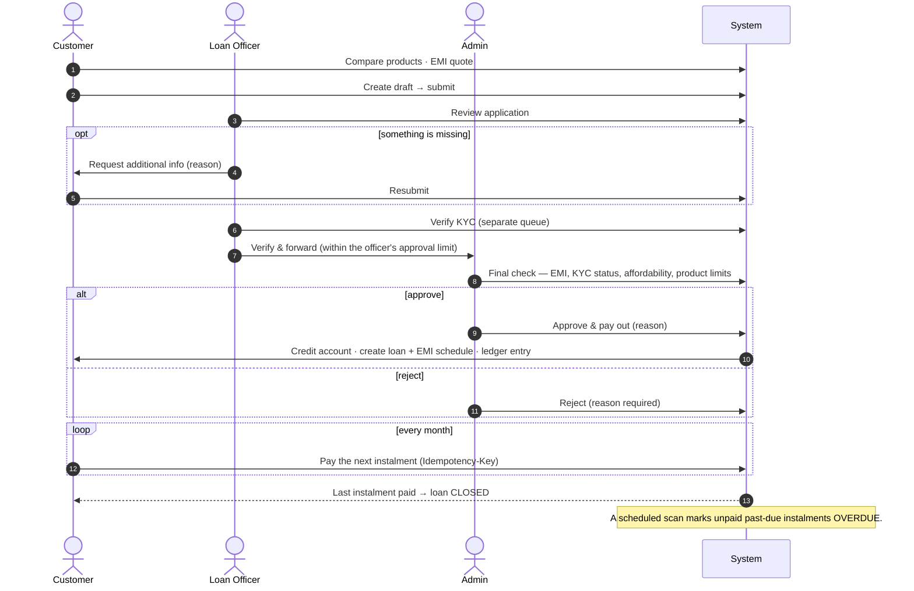

### 5 · The EMI math

Reducing-balance EMI, computed with `BigDecimal` (no floating-point money):

$$
EMI = \frac{P \cdot r \cdot (1 + r)^n}{(1 + r)^n - 1}
\qquad r = \frac{\text{annual rate}}{12 \times 100}
$$

| Example | Result |
|---|---|
| ₹1,00,000 at 12 % for 12 months | **EMI ₹8,884.88** — first month: interest ₹1,000.00, principal ₹7,884.88 |
| ₹1,000 at 0 % for 3 months | ₹333.33, ₹333.33, **₹333.34** (the last instalment absorbs rounding) |

---

<a id="data-model"></a>

## 🗄️ Data model

14 tables, created by Flyway migrations **V1 → V6**. All money is `DECIMAL(15,2)`; timestamps are UTC.

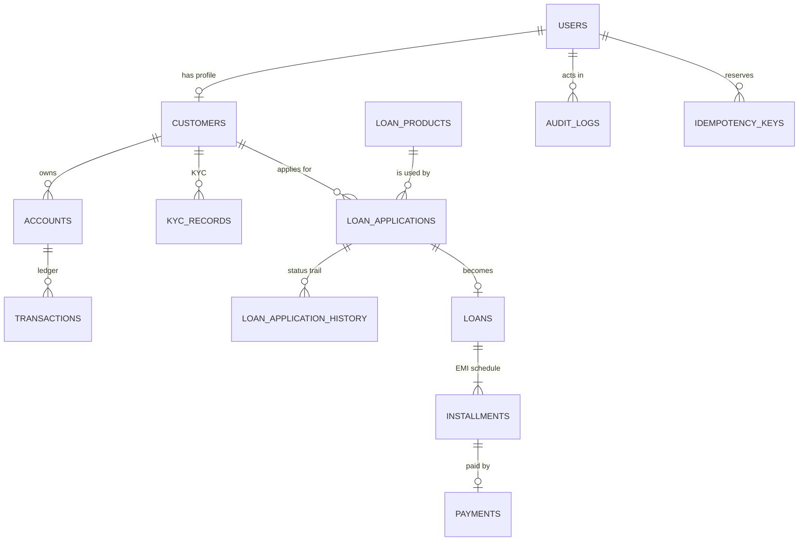

<sub>Plus <code>system_settings</code> (lockout rules and other reference settings).</sub>

| Rule in the database | Why it matters |
|---|---|
| `ck_accounts_balance` — balance ≥ 0 | No overdrafts, ever |
| `ck_applications_rejection_reason` | A rejection without a reason cannot be saved |
| `ck_users_approval_limit` | Staff must have a positive approval limit; customers have none |
| Unique `(user, operation, key)` on idempotency keys | The same request cannot run twice |
| Ledger, payments, history and audit are insert-only | Money history is never edited or deleted — corrections are new rows |

---

<a id="security"></a>

## 🔐 Security & data integrity

| Threat | Defence |
|---|---|
| Token theft by JavaScript | JWT lives in an **HttpOnly** `FN_ACCESS` cookie — never in `localStorage` |
| Cross-site request forgery | Cookie + header **CSRF** check on every POST / PUT / PATCH / DELETE, including login |
| Weak or guessed passwords | **BCrypt** (cost 12), strong password policy, lockout after 5 failed attempts |
| Stale sessions | `token_version`, enabled flag and role re-checked in the DB on each request |
| Privilege escalation | `@PreAuthorize` on services + ownership checks; DTOs reject role / balance / owner fields |
| Double payments | **Idempotency-Key** on transfers, repayments and admin credit |
| Race conditions | Row locks in a fixed order + DB constraints, proven by parallel MySQL tests |
| Partial failures | One transaction per money movement — tested by injected faults |
| Abuse | Rate limits on financial endpoints (HTTP 429 with Retry-After) |
| Secret leaks | `.env` and keys are git-ignored; test secrets come from environment variables |

### Roles & permissions

| Capability | 🙋 Customer | 🧑‍💼 Officer | 🛡️ Admin |
|---|:---:|:---:|:---:|
| Own accounts, transfers, receipts | ✅ | — | 👁️ view all |
| Apply for and repay loans | ✅ | — | — |
| Review loans, request info, verify & forward | — | ✅ | ✅ |
| Final approval & pay-out | — | — | ✅ |
| KYC decisions | — | ✅ | 👁️ view only |
| Users, roles, approval limits | — | — | ✅ |
| Loan-product management | — | — | ✅ |
| Audit-log search | — | own actions | everything |
| Dashboards & reports | own data | loan portfolio | whole bank |

---

## 🧰 Tech stack

| | Technology |
|---|---|
| **Backend** | Java 21 · Spring Boot 3.5 · Spring Security · Spring Data JPA (Hibernate 6.6) · Bean Validation · Maven Wrapper |
| **Database** | MySQL 8.4 (InnoDB) · Flyway migrations V1–V6 |
| **Frontend** | React 18.3 · Vite 7 · React Router 6 · Axios · Bootstrap 5 · lucide-react · framer-motion |
| **Testing** | JUnit 5 · Spring Boot Test · MockMvc · Mockito · real MySQL test schema |
| **Tooling** | Git & GitHub · Windows PowerShell setup scripts |

---

<a id="getting-started"></a>

## 🚀 Getting started

**You need:** JDK 21 · Node.js with npm · MySQL 8 · Git · Windows PowerShell

<details>
<summary><b>① First-time setup</b> (database, secrets, demo users)</summary>

<br/>

Run from the project root in a PowerShell window started with
`powershell.exe -NoProfile -ExecutionPolicy RemoteSigned`:

```powershell
git clone https://github.com/abdulsalam025/FinNova-bank.git
cd FinNova-bank

# 1. Create the finnova_demo and finnova_test schemas + restricted MySQL users (asks for the MySQL root password)
.\scripts\Initialize-FinNovaDatabase.ps1 -Mode Prepare
. .\scripts\Use-FinNovaEnvironment.ps1

# 2. Apply the Flyway migrations to both schemas, then grant runtime permissions
.\scripts\Run-FinNovaStage2.ps1 -Mode Migrate
.\scripts\Initialize-FinNovaDatabase.ps1 -Mode Grant

# 3. Generate a random JWT signing key into the private .env
.\scripts\Initialize-FinNovaSecurity.ps1

# 4. Choose passwords for the four synthetic demo users (customer1, customer2, officer, admin)
.\scripts\Initialize-FinNovaDemoUsers.ps1
```

The tests need their own JWT secret in an environment variable (set it once):

```powershell
$b = New-Object byte[] 32
[Security.Cryptography.RandomNumberGenerator]::Create().GetBytes($b)
[Environment]::SetEnvironmentVariable("FINNOVA_DBTEST_APP_SECURITY_JWT_SECRET", [Convert]::ToBase64String($b), "User")
```

Open a new PowerShell window afterwards so the variable is picked up. The full stage-by-stage notes are in [`docs/STAGE_NOTES.md`](docs/STAGE_NOTES.md).

</details>

**② Start the backend** (port 8080)

```powershell
. .\scripts\Use-FinNovaEnvironment.ps1
cd backend
.\mvnw.cmd spring-boot:run
```

**③ Start the frontend** (new window)

```powershell
cd frontend
npm install
npm run dev
```

Open **http://127.0.0.1:5173** — Vite proxies `/api` to the backend. Health check: `GET /api/health` reports status `UP`.

> [!TIP]
> Use `127.0.0.1` for both servers. Mixing `localhost` and `127.0.0.1` splits the host-only cookies.

---

<a id="tests"></a>

## 🧪 Tests

```powershell
cd backend
.\mvnw.cmd test        # backend: JUnit 5 against the finnova_test schema
cd ..\frontend
npm run build          # frontend production build
```

<div align="center">

| Run (21 Oct 2026) | Tests | ✅ Passed | ❌ Failures | 💥 Errors | ⏭️ Skipped |
|---|:---:|:---:|:---:|:---:|:---:|
| Backend — full suite | **107** | **107** | 0 | 0 | 0 |
| Frontend — `npm run build` | — | ✅ built | — | — | — |

</div>

| Test suite | What it proves |
|---|---|
| `DatabaseMigrationTest` | Schema, constraints, grants and seed data reconcile |
| `AuthSecurityTest` · `CsrfContinuityTest` | Registration, BCrypt, HttpOnly cookie, CSRF, lockout, token revocation |
| `RateLimitHttpTest` · `TransferRateLimitHttpTest` | Limits answer HTTP 429 |
| `BankingApiTest` | Accounts, ownership, filters and transfers over HTTP |
| `TransferConcurrencyTest` · `TransferRollbackTest` | Parallel transfers on real MySQL; injected failures roll back everything |
| `EmiEngineTest` | EMI maths matches independent examples |
| `LoanWorkflowTest` · `LoanLifecycleTest` | The full loan chain, permissions and invalid transitions |
| `RepaymentConcurrencyTest` · `RepaymentRollbackTest` | One instalment can never be paid twice; failures roll back |
| `ManagementTest` · `AdminConcurrencyTest` | Users, products, KYC, audit, reports; two admins cannot lock each other out |
| `HealthControllerTest` | Liveness endpoint |

---

## 📁 Project structure

```text
FinNova-bank/
├── backend/                         Spring Boot application (Maven Wrapper)
│   ├── src/main/java/com/finnova/bank/
│   │   ├── auth/        sign-in, JWT cookie, CSRF, profile
│   │   ├── banking/     accounts, transfers, ledger, idempotency, admin credit
│   │   ├── loans/       products, applications, EMI, disbursement, repayment, overdue
│   │   ├── officer/     officer workspace APIs
│   │   ├── admin/       management API, user administration
│   │   ├── reports/     dashboards and reports
│   │   ├── audit/       immutable audit log + search
│   │   ├── security/    security configuration and filters
│   │   ├── common/      error format, exceptions
│   │   ├── demo/        demo-user provisioning
│   │   └── health/      /api/health
│   ├── src/main/resources/db/migration/   Flyway V1 → V6
│   └── src/test/java/                     JUnit 5 test suites
├── frontend/                        React + Vite
│   └── src/  pages/ · components/ · api/ · routes/ · context/ · hooks/ · utils/
├── scripts/                         PowerShell setup, run and verification helpers
├── docs/                            stage notes, images, verification logs
└── .env.example                     documented settings — no secrets
```

---

## 🗺️ Limitations & roadmap

**Known limitations** — honest by design:

- A local, single-server lab: HTTP on loopback, an in-memory rate limiter and a plaintext `.env` protected only by Windows file permissions. **Not production-secure.**
- No real payment rails, no KYC document upload, no partial prepayment or late fees.
- Cards, Investments, Messages and Settings are static placeholder pages.
- The frontend bundle is larger than 500 kB (Vite warns); Flyway warns that MySQL 8.4 is newer than it has been tested with.

**Ideas for next steps:**

- [ ] Payment-gateway sandbox and downloadable statements
- [ ] Secure KYC document upload with an in-browser preview for officers
- [ ] Email / SMS notifications for decisions and due instalments
- [ ] Two-factor authentication for staff accounts
- [ ] Code-splitting, frontend tests (Vitest, Playwright) and a CI pipeline

---

<div align="center">

**FinNova Bank** · college group project · synthetic data only

<sub>No open-source licence is included — all rights reserved by the project team.<br/>
The detailed build history lives in <a href="docs/STAGE_NOTES.md">docs/STAGE_NOTES.md</a>.</sub>

</div>
